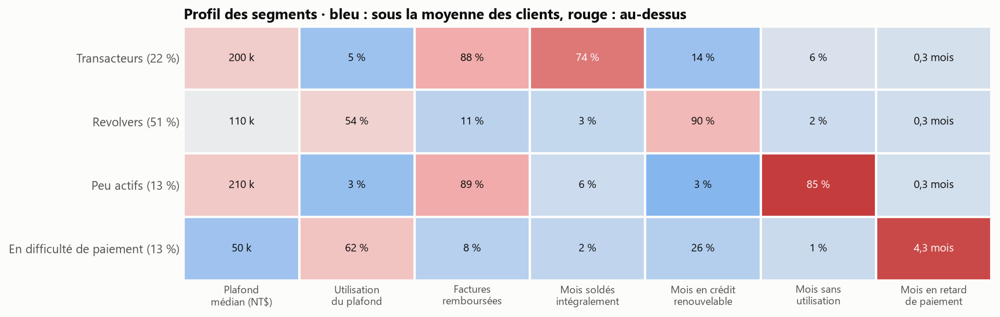
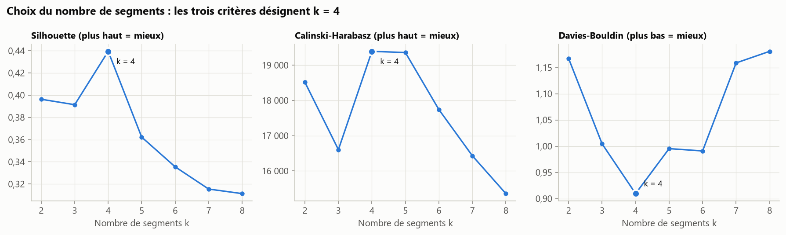
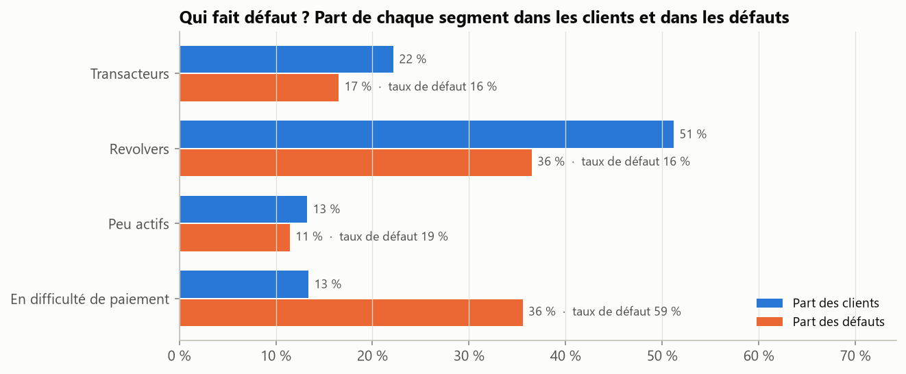

# Segmentation comportementale de porteurs de carte de crédit

[](https://github.com/narusly/segmentation-clients/actions/workflows/tests.yml)

K-means sur 30 000 porteurs de carte de crédit, à partir de 6 mois de factures, de remboursements et
d'incidents de paiement : quatre segments stables, interprétables, puis confrontés au défaut de paiement.

## En bref

- **Quatre segments**, désignés par les trois critères internes (silhouette, Calinski-Harabasz,
  Davies-Bouldin) et très stables : ARI moyen de 0,997 sur 20 rééchantillons bootstrap.
- **13 % des clients concentrent 36 % des défauts.** Le segment « En difficulté de paiement » cumule en
  moyenne 4,3 mois de retard sur 6 et fait défaut à 59 %, contre 22 % en moyenne.
- **Utiliser son crédit renouvelable n'est pas un signe de risque.** Les « Revolvers », la moitié des
  clients, font moins défaut (15,8 %) que la moyenne.
- **Le comportement sépare les clients, pas l'âge.** L'âge diffère « significativement » entre segments
  (p = 2,2 × 10⁻⁶⁵), mais l'effet est négligeable (ε² = 0,01). Avec 30 000 clients, une p-value seule ne
  dit rien : il faut la taille d'effet.



## Problème

Une banque ne pilote pas 30 000 clients un par un. Segmenter, c'est regrouper les clients qui se
comportent de la même façon pour adapter l'offre, la prévention ou le recouvrement. Encore faut-il que les
segments soient justifiés par les données, stables, et compréhensibles par les métiers.

## Données

[*Default of Credit Card Clients*](https://archive.ics.uci.edu/dataset/350/default+of+credit+card+clients)
(UCI, licence CC BY 4.0 ; Yeh et Lien, 2009) : 30 000 porteurs de carte à Taïwan, d'avril à septembre 2005,
montants en NT$. Le taux de défaut global (22 %) est propre à ce contexte et ne se transpose pas tel quel.
Les données sont téléchargées automatiquement au premier lancement.

## Méthode

1. **Sept indicateurs de comportement** construits sur 6 mois : plafond (log), taux d'utilisation,
   part des factures remboursée, et part des mois soldés, en crédit renouvelable, sans utilisation ou en
   retard. Les variables démographiques et le défaut **n'entrent pas** dans la segmentation : ils servent
   seulement à l'interpréter, pour éviter toute fuite d'information.
2. **Standardisation** puis K-means (20 initialisations).
3. **Choix de k** par trois critères internes, sur k = 2 à 8.
4. **Stabilité** : K-means refait sur 20 rééchantillons bootstrap, puis comparé à la segmentation de
   référence sur les mêmes clients (indice de Rand ajusté).
5. **Nommage automatique** par règles sur les centres (le plus en retard, le plus inactif…), pour ne pas
   dépendre du numéro arbitraire que K-means attribue aux segments.
6. **Interprétation** : taux de défaut avec intervalle de Wilson, test du χ² et V de Cramér, Kruskal-Wallis
   et ε² pour les variables continues.



## Résultats

| Segment | Clients | Taux de défaut [IC 95 %] | Part des défauts |
|---|---:|---:|---:|
| Transacteurs : soldent leur carte 3 mois sur 4 | 22 % | 16,5 % [15,6 ; 17,4] | 17 % |
| Revolvers : crédit renouvelable 9 mois sur 10 | 51 % | 15,8 % [15,2 ; 16,4] | 36 % |
| Peu actifs : 85 % des mois sans utilisation | 13 % | 19,1 % [17,9 ; 20,4] | 11 % |
| En difficulté de paiement : 4,3 mois de retard | 13 % | 58,8 % [57,2 ; 60,3] | 36 % |



Le lien entre segment et défaut est réel mais modéré (V de Cramér = 0,35). La segmentation décrit des
comportements ; elle ne remplace pas un score individuel de risque (voir le projet
[scoring-appetence](https://github.com/narusly/scoring-appetence) pour la modélisation prédictive).

**Pistes d'usage pour une banque**, à valider avec les métiers :
- *En difficulté de paiement* : détection précoce et accompagnement (prévention du surendettement,
  recouvrement amiable) ;
- *Peu actifs* : des plafonds élevés (210 k NT$ en médiane) presque inutilisés, à réactiver ou à revoir ;
- *Transacteurs* : peu de crédit consommé, mais une forte activité de paiement, propice aux offres de
  services ;
- *Revolvers* : le cœur de l'activité de crédit renouvelable, à suivre en priorité pour leur taux
  d'utilisation (54 % du plafond en moyenne).

## Limites et pistes

- K-means suppose des segments « sphériques » de tailles comparables. Un modèle de mélange gaussien
  donnerait des probabilités d'appartenance plutôt qu'une affectation stricte.
- Six mois d'historique seulement, en 2005 : la segmentation serait à recalculer et à suivre dans le temps
  (migrations entre segments).

## Reproduire

```bash
python -m venv .venv
source .venv/bin/activate            # Windows : .venv\Scripts\activate
pip install -e ".[dev]"
pytest                               # 6 tests
python -m segmentation.report        # télécharge les données, régénère reports/ (environ 2 minutes)
```

## Structure

```
src/segmentation/data.py     téléchargement UCI, indicateurs de comportement
src/segmentation/model.py    choix de k, K-means, stabilité bootstrap, nommage des segments
src/segmentation/stats.py    intervalle de Wilson, V de Cramér, Kruskal-Wallis et ε²
src/segmentation/report.py   analyse complète, tableaux et figures
tests/                       indicateurs, nommage, stabilité, statistiques
```

---
Maxime Fruntes · Master 2 Mathématiques appliquées (Probabilités et Statistiques), Université de Lorraine ·
[LinkedIn](https://www.linkedin.com/in/maxime-fruntes-2538543a5/) · Licence MIT
